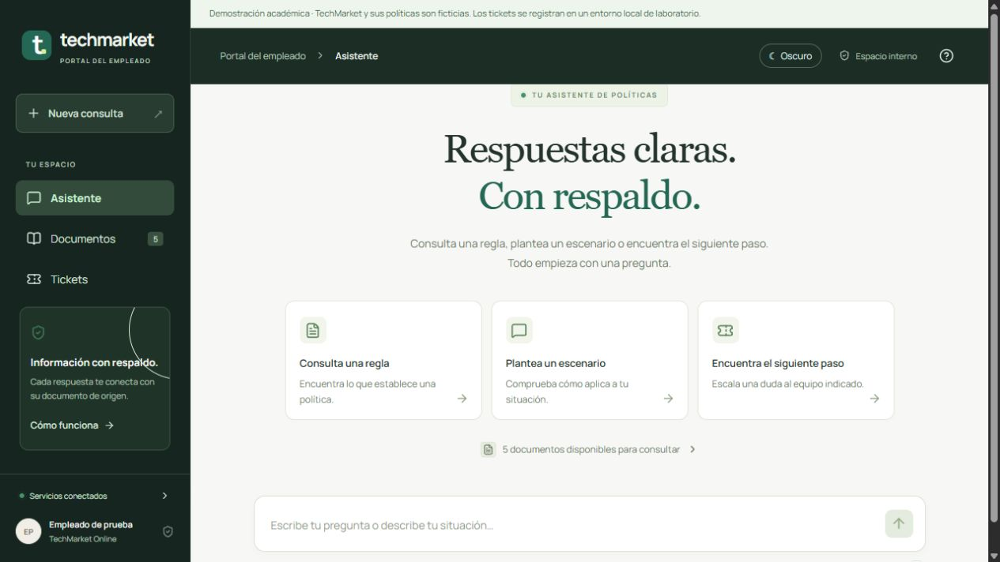
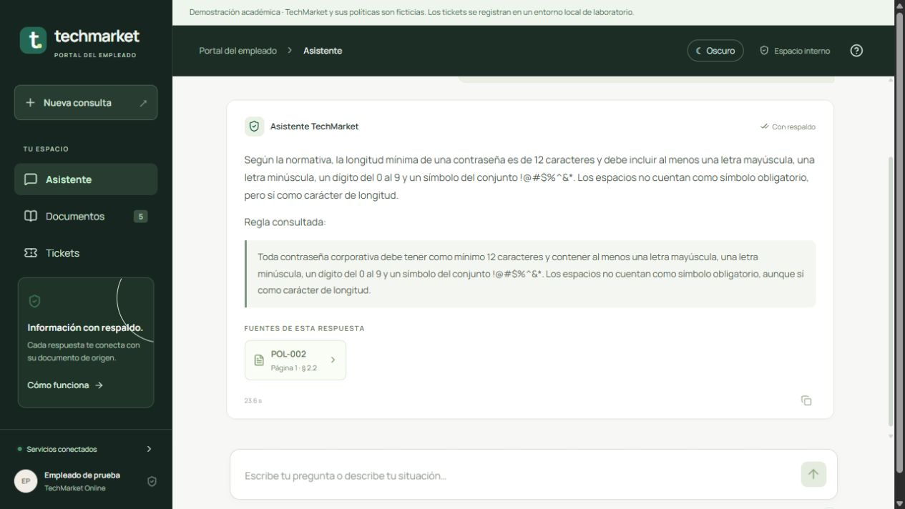
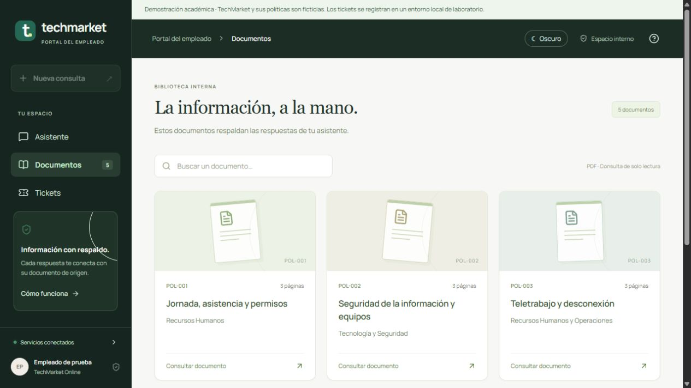
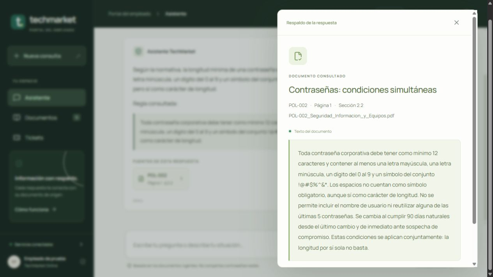
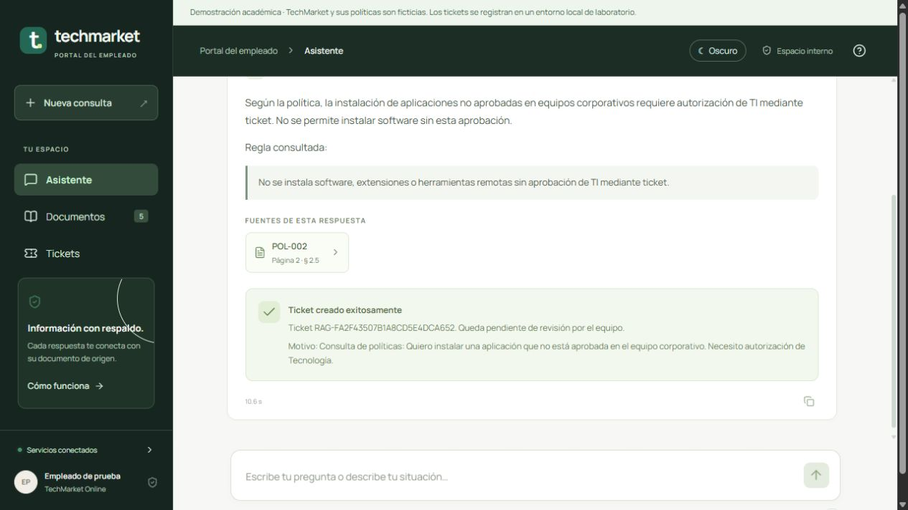
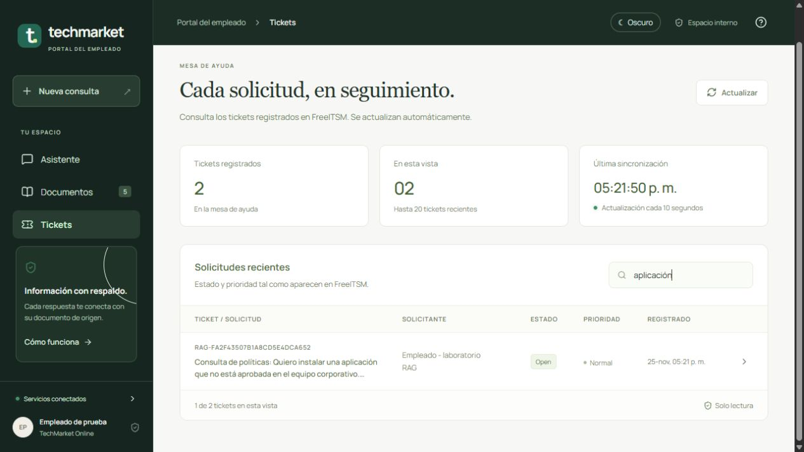
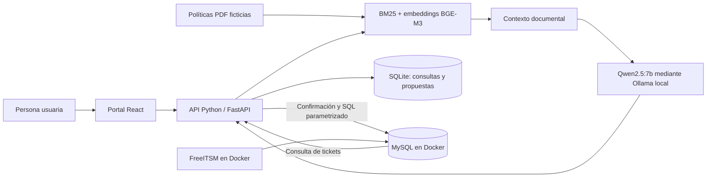

# Caso de estudio: asistente documental con RAG

**Ollama · Qwen2.5 · BGE-M3 · Python/FastAPI · React · MySQL · FreeITSM · Docker**

En este proyecto universitario grupal exploré cómo podría funcionar un asistente interno para consultar documentos de una empresa y llevar una solicitud a la mesa de ayuda cuando necesita revisión humana. Trabajamos con **TechMarket**, una empresa ficticia, cinco políticas PDF y modelos ejecutados localmente con Ollama.

Aquí presento el problema, el recorrido, la arquitectura y lo que aprendí. La implementación está en un repositorio privado; este caso se puede revisar sin credenciales ni acceso al código.

## Qué aprendí con este proyecto

El aprendizaje principal fue comprender que **un RAG interno puede acercar la información a las personas, pero tiene que justificar su utilidad y su costo**. Tener una respuesta fluida no basta: importa de qué documento sale, si responde bien y cuándo debe intervenir alguien.

| Área | Aprendizaje que destaco | Ejemplo del caso |
|---|---|---|
| RAG y modelos locales | Comprendí cómo recuperar información propia y entregarla como contexto a un modelo preentrenado | Buscar una regla en los PDF antes de responder |
| Privacidad | Entendí la ventaja de procesar consultas y documentos dentro de un entorno controlado, junto con la responsabilidad de protegerlos | Inferencia local, corpus ficticio y configuración privada separada |
| Negocio y costos | Aprendí a plantear cuándo una solución así podría tener sentido frente a una búsqueda o FAQ más sencilla | Comparar tiempo ahorrado y calidad con equipo, energía, mantenimiento y revisión |
| Soporte e integración | Comprendí cómo una consulta puede terminar en una solicitud registrada, sin que la IA la apruebe | Confirmación del ticket y consulta de su estado en FreeITSM |
| Infraestructura | Relacioné modelos, memoria, aplicaciones y persistencia | Ollama en el equipo; MySQL y FreeITSM en contenedores propios |

**En este caso no entrenamos ni ajustamos los pesos de una IA.** Indexamos documentos y usamos recuperación y generación con modelos preentrenados. Es una distinción que aprendí a reconocer: incorporar información a un RAG no equivale a entrenar un modelo.

Desarrollo esta reflexión en [Aprendizajes, privacidad y costos](docs/APRENDIZAJES_PRIVACIDAD_Y_COSTOS.md). No calculamos un ahorro empresarial ni un retorno de inversión real.

## Problema y objetivo

Las políticas de una organización pueden estar repartidas en documentos que las personas necesitan leer para resolver una duda. Una búsqueda por palabras ayuda a encontrarlos, pero todavía hay que interpretar la regla y distinguir una consulta de una solicitud que requiere autorización.

El prototipo busca responder preguntas con respaldo documental y facilitar ese siguiente paso. Exploramos tres preguntas:

- ¿Cómo responder usando el contenido de los documentos y mostrar su origen?
- ¿Cómo reconocer límites de la información y ofrecer revisión humana?
- ¿Cómo registrar una solicitud confirmada sin convertir al asistente en quien autoriza?

## Cómo funciona

1. La persona escribe una pregunta en el portal.
2. El backend recupera fragmentos mediante búsqueda por palabras y embeddings.
3. Qwen2.5 genera una respuesta con el contexto recuperado y otra llamada revisa su respaldo.
4. El servidor vincula las citas con archivo, sección y página del PDF.
5. Cuando corresponde, prepara un ticket que la persona confirma. La solicitud queda pendiente de revisión en FreeITSM.

Una cita permite comprobar la fuente; no garantiza por sí sola que toda la interpretación sea correcta. La revisión humana sigue siendo necesaria para evaluar la calidad y decidir autorizaciones.

## Resultados comprobados

| Evidencia | Qué se observó | Alcance |
|---|---|---|
| Corpus local | 5 PDF ficticios, 15 páginas y 60 fragmentos | Tamaño de esta versión del laboratorio |
| Pruebas del backend | 23 pruebas aprobadas | Contratos, citas, historial, propuestas, duplicados y transacciones; usan modelos simulados |
| Recorrido con servicios reales | 10 comprobaciones correctas | Consulta, PDF, modelos, abstención y ticket con FreeITSM local |
| Persistencia | El ticket se conservó al reiniciar los contenedores | No equivale a una prueba de respaldo y restauración |
| Recorrido de las capturas | Respuesta con fuente y solicitud de software registrada | Demostración real con datos ficticios |

No presento estas pruebas como un porcentaje de precisión del RAG. El proyecto mostró también errores de interpretación en evaluaciones anteriores; un verificador basado en el mismo modelo puede aceptar errores. [Resultados y límites](docs/RESULTADOS_Y_LIMITES.md) distingue las pruebas funcionales de una evaluación de calidad.

## Recorrido visual

Capturas reales del laboratorio local del **25 de noviembre de 2026**. Se pueden abrir para leerlas a tamaño completo.

| Consultar y revisar | Documentos y trazabilidad |
|---|---|
|  |  |
| **Consulta con respaldo.** Responde sobre longitud y composición de contraseñas y enlaza POL-002, página 1, sección 2.2. | **Documentos disponibles.** El portal permite consultar las cinco políticas ficticias; la captura muestra las primeras tres tarjetas. |
|  |  |
| **Fuente verificable.** Abre el fragmento literal y ofrece acceso a la página del documento. | **Revisión humana.** Una solicitud para instalar software no aprobado se registra después de confirmarla. Crear el ticket no autoriza instalarlo. |

**Seguimiento.** El portal consulta tickets de FreeITSM. La búsqueda «aplicación» muestra la solicitud recién creada: una fila filtrada de dos tickets de laboratorio. No representa el volumen de trabajo de una empresa.

## Tecnologías y arquitectura local

Ollama, el backend y la interfaz se ejecutan en el equipo; Docker aloja FreeITSM y MySQL. No todos los componentes están en contenedores. La integración de tickets actual utiliza SQL directo y **no ejecuta los hooks, notificaciones ni automatismos SLA de FreeITSM**. No hay demo pública ni despliegue VPS activo de este caso. [Arquitectura y operación](docs/ARQUITECTURA_Y_OPERACION.md).

## Mi participación

El trabajo fue grupal. Participé en definir cómo debía responder el asistente, pedir y revisar ajustes y probar las respuestas y la integración de tickets. Utilizamos ampliamente IA para implementar y corregir código; no presento el desarrollo como programación individual escrita a mano. La preparación local, las pruebas y esta documentación también tuvieron asistencia del agente.

Mi interés en este caso está en comprender la integración, la operación y el valor para una organización: cuándo usarla, qué información maneja y qué costos y riesgos implica. [Participación y procedencia](docs/PARTICIPACION.md).

## Documentación

- [Aprendizajes, privacidad y costos](docs/APRENDIZAJES_PRIVACIDAD_Y_COSTOS.md).
- [Arquitectura y operación](docs/ARQUITECTURA_Y_OPERACION.md).
- [Resultados y límites](docs/RESULTADOS_Y_LIMITES.md).
- [Evidencias del recorrido](docs/EVIDENCIAS.md).
- [Participación y procedencia](docs/PARTICIPACION.md).

**Demostración académica con empresa, políticas y solicitante ficticios.** Este repositorio publica la presentación y las capturas seleccionadas; no distribuye implementación, modelos, base de datos, credenciales ni conversaciones completas.
